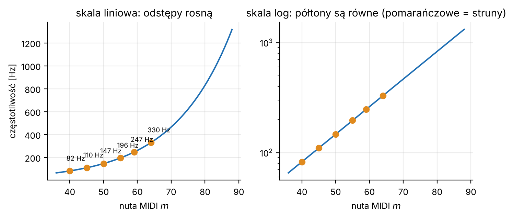
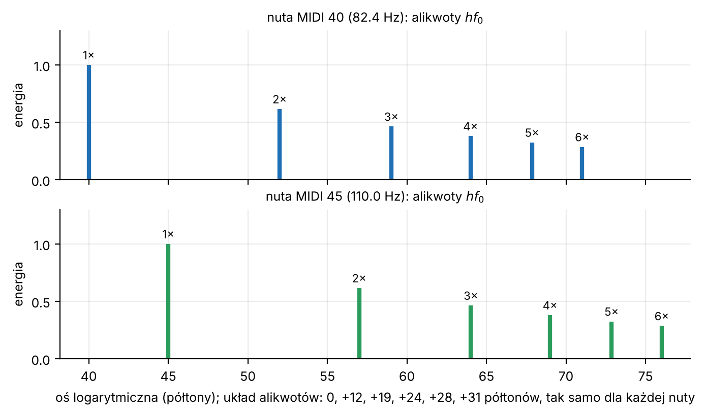
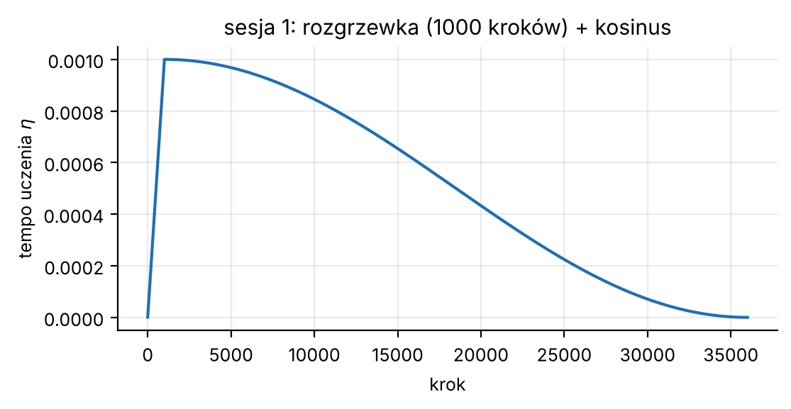
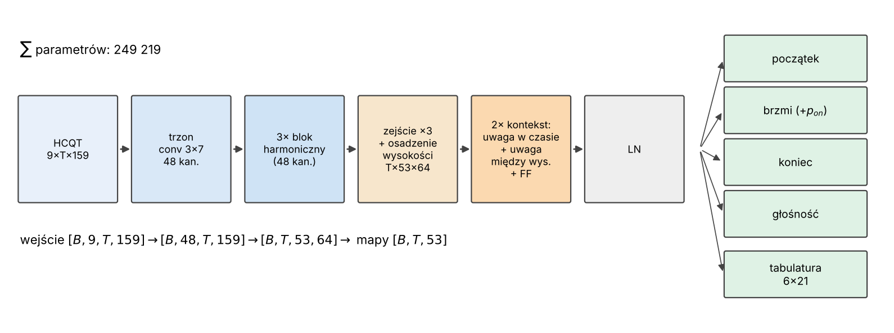
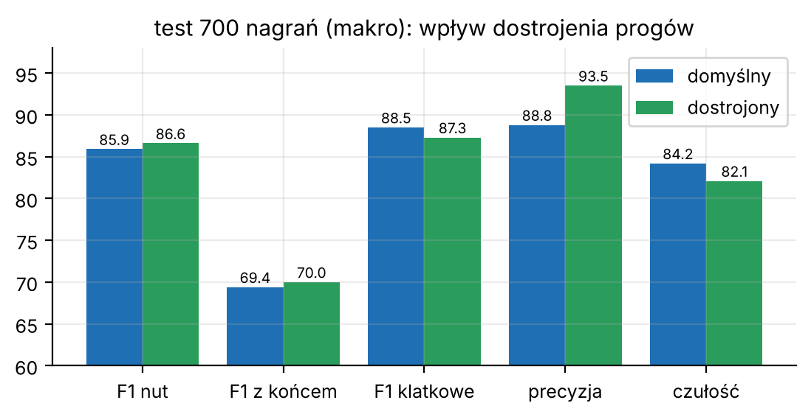

# Streszczenie

Opisujemy model **Gen 6** projektu Gutar: sieć neuronową, która z nagrania gitary (także z innych instrumentów) odtwarza **listę nut** (wysokość, początek, koniec) oraz **tabulaturę** (na której strunie i którym progiem zagrano daną nutę). Wejściem jest harmonicznie ułożone widmo (HCQT, 9 kanałów × 159 binów co 1/3 półtonu, krok 23 ms). Sieć ma 249 219 parametrów: trzon konwolucyjny z trzema *blokami harmonicznymi*, które patrzą jednocześnie na całą serię alikwotów kandydata na wysokość, oraz dwie warstwy kontekstu z *uwagą w czasie* (w obie strony, okno ±1 s) i *uwagą między wysokościami* (oktawy, kwinty, akord jako całość). Pięć głowic przewiduje: początek, trwanie, koniec, głośność i tabulaturę. Uczono ją łącznie 97 epok na ok. 56 godzinach nagrań (głównie syntetycznych, z domieszką prawdziwej gitary z GuitarSet), a nuty wydobywa deterministyczny dekoder z dostrojonymi progami.

Na 700 nagraniach testowych (180 GuitarSet + 520 syntetycznych utworów, nieużytych w uczeniu) model osiąga makro-F1 nut **86,6 %** i F1 nut z poprawnym końcem **70,0 %**. Na GuitarSet (gracze 03–05) F1 nut wynosi 87,2 % (domyślny dekoder) wobec 79,5 % dla poprzedniej generacji.

Główną część dokumentu stanowi jednak wyjaśnienie **całej matematyki** użytej w modelu, tak aby każdy wzór dało się zrozumieć bez wcześniejszej wiedzy: od częstotliwości i decybeli, przez transformatę Fouriera, konwolucję i uwagę (*attention*), po funkcje strat, optymalizator AdamW i miary jakości.

# Jak czytać ten dokument

* **Część I** (rozdziały M1–M14) uczy matematyki **po kolei**, każdy wzór ma trzy elementy: *intuicję* (po ludzku), *wzór* i *przykład liczbowy*. Wszystkie liczby w przykładach policzono naprawdę.
* **Część II** (rozdziały 1–12) to właściwa praca naukowa. Na każdy wzór wskazuje, w którym rozdziale Części I jest wyjaśniony (np. „zob. M9”).
* **Rysunki** (15 szt.) są generowane skryptem `tools/make_figures_paper.py`: rysunek 4 to prawdziwe wyjście kodu cech, rysunki 13–15 pochodzą z plików wyników w `docs/wyniki/`, a rysunki 7 (środek) i 11 są poglądowe i jako takie opisane.
* **Przykłady liczbowe** są oznaczone słowem „Przykład” i można je sprawdzić ręcznie.
* **Dodatki**: tabela wszystkich 249 219 parametrów (A), ściąga symboli (B).
* Odwołania do kodu mają postać `plik:funkcja` i dotyczą katalogu `tools/gen6/`.

Oznaczenia, które wracają w całym tekście:

| symbol | znaczenie | wartość w modelu |
|---|---|---|
| $f_s$ | częstotliwość próbkowania | 11 025 Hz |
| $T$ | liczba klatek czasowych nagrania | zależy od długości |
| $S$ | liczba półtonów (wysokości) | 53 (MIDI 36–88) |
| $P$ | liczba binów częstotliwości | 159 ($=3S$) |
| $C$ | liczba kanałów wejścia (HCQT) | 9 |
| $H$, $D$ | liczba kanałów w trzonie / w warstwach kontekstu | 48 / 64 |
| $t$, $s$, $p$ | indeks klatki, półtonu, binu | |

---

# CZĘŚĆ I. MATEMATYKA KROK PO KROKU

## M1. Dźwięk jako ciąg liczb, próbkowanie

**Intuicja.** Mikrofon mierzy ciśnienie powietrza. Komputer nie zapisuje ciągłej krzywej, tylko **próbki**: ciśnienie mierzone co stały ułamek sekundy.

**Wzór.** Sygnał ciągły $x(\tau)$ (czas $\tau$ w sekundach) zamieniamy na ciąg

$$x[n] = x\!\left(\frac{n}{f_s}\right), \qquad n = 0,1,2,\dots$$

gdzie $f_s$ to liczba próbek na sekundę. Najwyższa częstotliwość, jaką da się jeszcze poprawnie zapisać, to **częstotliwość Nyquista** $f_s/2$ (twierdzenie o próbkowaniu): szybsze drgania „zawijają się” i udają wolniejsze.

**Przykład.** Gen 6 zmienia próbkowanie każdego nagrania na $f_s = 11\,025$ Hz. Nyquist to $11025/2 = 5512{,}5$ Hz. Najwyższa nuta modelu (MIDI 88, 1318,5 Hz) ma jeszcze 4 alikwoty poniżej Nyquista, a wyższe i tak są pomijane (w kodzie: alikwot powyżej $0{,}46 f_s$ = 5071,5 Hz jest zerowany). Jedna próbka trwa $1/11025 \approx 90{,}7\ \mu$s.

*(Dlaczego akurat 11 025 Hz? To 44 100 / 4. Ćwierć standardowego próbkowania płyt CD wystarcza, bo gitara nie niesie użytecznej informacji o wysokości powyżej kilku kHz, a obliczenia są 4× tańsze.)*

## M2. Wysokość dźwięku: Hz, półtony, centy, MIDI

**Intuicja.** Ucho słyszy wysokość **logarytmicznie**: podwojenie częstotliwości to zawsze „oktawa wyżej”, niezależnie od tego, czy z 100 Hz na 200 Hz, czy z 1000 na 2000. Dlatego muzycy dzielą oktawę na 12 równych (w sensie ilorazu) półtonów.

**Wzór (MIDI → Hz).** Numer nuty MIDI $m$ (np. 69 = A4 = 440 Hz) ma częstotliwość

$$f(m) = 440 \cdot 2^{\frac{m-69}{12}}\ \text{Hz}.$$

Każdy półton w górę mnoży częstotliwość przez $2^{1/12} \approx 1{,}0595$. Odwrotnie: $m = 69 + 12\log_2\!\big(f/440\big)$.

**Centy.** Półton dzielimy na 100 centów. Odstęp między częstotliwościami $f_1, f_2$ w centach to

$$c = 1200\,\log_2\!\frac{f_2}{f_1}.$$

(Oktawa $= 1200$ ¢, półton $=100$ ¢, bo $1200\log_2 2 = 1200$ i $1200\log_2 2^{1/12} = 100$.)

**Przykłady.**

* Najniższa struna gitary E2: $m=40$, $f = 440\cdot 2^{(40-69)/12} = 82{,}41$ Hz. Struna E4 ($m=64$): $329{,}63$ Hz.
* Strój gitary w kodzie: `tuning = (40, 45, 50, 55, 59, 64)` czyli E2 A2 D3 G3 B3 E4.
* Odstęp półtonu przy E2 to tylko $82{,}41\cdot(2^{1/12}-1) = 4{,}9$ Hz. To ważne: wąskie odstępy w niskich tonach wymagają **długiego okna** analizy (zob. M4).
* **Biny 1/3 półtonu.** Model dzieli każdy półton na 3 biny po $100/3\approx 33{,}3$ ¢. Bin $p$ ma wysokość MIDI

$$m(p) = 36 + \frac{p-1}{3}, \qquad p=0,\dots,158.$$

  Zatem bin $p = 3s+1$ leży **dokładnie** na półtonie $36+s$, a biny $3s$ i $3s+2$ to „odrobinę za nisko” i „odrobinę za wysoko” (±33 ¢). Dzięki temu gitara rozstrojona o kilkanaście centów nadal trafia w którąś z trzech komórek.

{width=95%}

## M3. Alikwoty (harmoniczne)

**Intuicja.** Szarpnięta struna nie drga tylko jednym tonem. Drga całą rodziną: z częstotliwością podstawową $f_0$ (to ją słyszymy jako wysokość nuty) i z jej **wielokrotnościami** — alikwotami, które nadają barwę. Dlatego nie wystarczy szukać piku widma w $f_0$: pik w $2f_0$ może być zarówno drugim alikwotem niższej nuty, jak i podstawą wyższej (**błąd oktawowy**, największy problem transkrypcji).

**Wzór.**

$$f_h = h\cdot f_0,\qquad h = 1,2,3,\dots$$

W półtonach $h$-ty alikwot leży $12\log_2 h$ półtonów nad podstawą, a w binach 1/3 półtonu:

$$k_h = 36\log_2 h \quad\text{binów}.$$

**Przykład.** Obliczone i zaokrąglone przesunięcia, których używa sieć (`harm_offsets`):

| alikwot $h$ | 0,5 | 1 | 2 | 3 | 4 | 5 | 6 |
|---|---|---|---|---|---|---|---|
| $36\log_2 h$ | −36 | 0 | 36 | 57,06 | 72 | 83,59 | 93,06 |
| przesunięcie $k_h$ (biny) | −36 | 0 | 36 | 57 | 72 | 84 | 93 |

Oktawa wyżej ($h=2$) to dokładnie 12 półtonów $=36$ binów; kwinta nad oktawą ($h=3$) to $12+7=19$ półtonów $\approx 57$ binów (zaokrąglenie, bo $12\log_2 3 = 19{,}02$). Wartość $h=0{,}5$ to **subharmoniczna**, czyli oktawa niżej: pozwala sieci zauważyć, że „to, co widzę, jest alikwotem czegoś niższego”.

**Kluczowa obserwacja.** Na osi **logarytmicznej** (biny co 1/3 półtonu) układ alikwotów jest taki sam dla każdej nuty: zawsze −36, 0, +36, +57, … binów od podstawy. To pozwala użyć jednego, wspólnego „detektora wzorca” dla wszystkich wysokości (zob. M6, blok harmoniczny).

{width=95%}

**Przykład krok po kroku (nuta E2, struna 6 pusta).** Półton $s=40-36=4$, więc bin $p=3\cdot4+1=13$. Blok harmoniczny czyta z tego binu siedem miejsc: $p+k$ dla $k=-36,0,36,57,72,84,93$, czyli biny $-23$ (poza zakresem, wstawia zera), $13,\ 49,\ 70,\ 85,\ 97,\ 106$. Zamieniamy je z powrotem na nuty ze wzoru $m(p)=36+(p-1)/3$: bin 13 → 40 (E2), 49 → 52 (E3), 70 → 59 (B3), 85 → 64 (E4), 97 → 68 (G♯4), 106 → 71 (B4). To dokładnie 1., 2., 3., 4., 5. i 6. alikwot E2. Jeśli w tych siedmiu miejscach wszędzie jest energia, kandydat „E2” jest bardzo prawdopodobny. Jeśli natomiast w binie 13 (podstawa) nic nie ma, a w 49, 85 i 106 jest energia, to raczej gra E3 (jego alikwoty to właśnie 49, 85, 106…), a „E2” byłoby błędem oktawowym. Blok harmoniczny widzi oba te miejsca naraz, więc może to rozróżnić.

## M4. Transformata Fouriera: z drgań do widma

**Intuicja.** Transformata Fouriera sprawdza, **ile** czystego tonu o każdej częstotliwości siedzi w krótkim fragmencie dźwięku — jak rozdzielenie akordu na pojedyncze struny.

**Wzór (DFT).** Dla ramki $N$ próbek $x[0..N-1]$:

$$X[k] = \sum_{n=0}^{N-1} x[n]\; e^{-2\pi i\,kn/N}, \qquad k = 0,\dots,N-1.$$

Wzór Eulera $e^{-i\phi} = \cos\phi - i\sin\phi$ pokazuje, co się dzieje: mnożymy sygnał przez falę cosinusową i sinusową o „numerze” $k$ i sumujemy. Jeśli sygnał zawiera ton o tej częstotliwości, wyrazy dodają się w fazie i suma jest duża; w przeciwnym razie plusy i minusy się znoszą. **Moduł** $|X[k]|$ mówi, *jak silny* jest ton $k$ (faza nas tu nie interesuje).

Biny $k$ odpowiadają częstotliwościom $k f_s/N$. **Rozdzielczość** widma to

$$\Delta f = \frac{f_s}{N}.$$

**Okno Hanna.** Ucięcie sygnału do $N$ próbek „odcina” go gwałtownie i rozmywa widmo (przeciek). Mnożymy więc ramkę przez gładkie okno

$$w[n] = \tfrac12\!\left(1 - \cos\frac{2\pi n}{N}\right), \qquad n=0,\dots,N-1,$$

które zaczyna i kończy się zerem (kod: `np.hanning(N+1)[:N]`, tzw. okno okresowe). Z oknem Hanna czysty ton o amplitudzie $A$ daje $|X| \approx A\,N/4$ (średnia okna to $\tfrac12$, a widmo rzeczywistego sygnału dzieli się na dwie połówki ±częstotliwość, razem $\tfrac12\cdot\tfrac12$). Dlatego kod mnoży wynik przez $4/N$, aby odczytać **amplitudę $A$ wprost**.

**Dopełnianie zerami (zero-padding).** Gdy do ramki dołożymy zera do długości $M = z\cdot N$ ($z=4$ w modelu), widmo staje się „gęściej próbkowane” (biny co $f_s/M$) — nie zyskujemy nowej informacji, ale krzywa jest gładsza i łatwiej odczytać położenie piku.

**Kompromis czas–częstotliwość.** Długie okno = dobra rozdzielczość częstotliwości, zła w czasie; krótkie okno odwrotnie. Gen 6 używa obu:

| okno | $N$ | czas trwania $N/f_s$ | $\Delta f = f_s/N$ | biny po zero-padding ($M=4N$) |
|---|---|---|---|---|
| długie | 4096 | 371,5 ms | 2,69 Hz | co 0,673 Hz |
| krótkie | 1024 | 92,9 ms | 10,77 Hz | co 2,69 Hz |

Półton przy E2 to 4,9 Hz, więc tylko okno długie (2,69 Hz) potrafi go rozdzielić; dlatego jest potrzebne. Krótkie okno lepiej „widzi” moment szarpnięcia.

{width=100%}

**Krok (hop).** Ramki przesuwamy o $\text{hop}=256$ próbek: $256/11025 = 23{,}2$ ms. Klatka $t$ ma środek w próbce $t\cdot 256 + N_L/2$, czyli w czasie

$$\tau_t = \frac{256\,t + 2048}{11025}\ \text{s}.$$

Obie ramki (długa i krótka) w klatce $t$ mają **ten sam środek**.

**Przykład wymiarów.** Nagranie 23 s ($\approx 253\,575$ próbek) daje $T = (253575 - 4096)/256 + 1 = 975$ klatek.

**Przykład: czas klatki.** Klatka $t=35$ ma środek w $\tau_{35}=(256\cdot35+2048)/11025=(8960+2048)/11025=0{,}9984$ s, czyli niemal dokładnie w 1,0 s nagrania.

## M5. HCQT: widmo „ułożone” harmonicznie

**Intuicja.** Zwykłe widmo ma biny liniowe (co $f_s/M$ Hz), a my chcemy biny logarytmiczne (co 1/3 półtonu) i dodatkowo — dla każdej kandydującej wysokości — informację, ile energii jest w jej 1×, 2×, 3×… wielokrotności. To właśnie **HCQT** (*Harmonic Constant-Q Transform*, Bittner i in. 2017, tu w odmianie liczonej z FFT).

**Wzór.** Dla kanału $c$ z listą alikwotów $h_c$, klatki $t$ i binu $p$ (wysokość $f(p)=440\cdot 2^{(m(p)-69)/12}$):

$$A_c(t,p) = \frac{4}{N_c}\;\max_{k\,\in\,[a,\,b]} \big|X^{(c)}_t[k]\big|, \qquad
a = \Big\lfloor \tfrac{h_c f(p)\,2^{-1/72}}{f_s/M_c} \Big\rfloor,\quad
b = \Big\lceil \tfrac{h_c f(p)\,2^{+1/72}}{f_s/M_c} \Big\rceil .$$

Czyli: patrzymy na częstotliwość $h_c f(p)$ i bierzemy **maksimum** widma w przedziale $\pm 1/72$ oktawy $=\pm 1/6$ półtonu ($\pm 16{,}7$ ¢) wokół niej. $M_c$ to długość FFT po zero-padding. Jeśli $h_c f(p)>0{,}46 f_s$, wynik to 0.

**Dziewięć kanałów** ($C=9$): sześć z okna długiego z alikwotami $h\in\{0{,}5; 1; 2; 3; 4; 5\}$ i trzy z okna krótkiego z $h\in\{1;2;3\}$. Kanał „$h=2$” w binie $p$ mówi więc: „ile jest energii w oktawie nad $p$”.

**Przykład liczbowy (E2).** Bin dokładnie na $m=40$: $f=82{,}41$ Hz. Przedział $\pm 1/72$ oktawy to $81{,}62$–$83{,}20$ Hz. Przy biniach co 0,673 Hz (okno długie, $M=16384$) wypada $a=\lfloor 121{,}3\rfloor = 121$, $b=\lceil 123{,}6\rceil=124$, czyli maksimum z 4 binów FFT. Dla $h=2$ ($164{,}81$ Hz): biny 242–248.

### Decybele i normalizacja

**Decybele.** Ucho i dynamika nagrań są logarytmiczne, więc amplitudę $A$ zamieniamy na decybele:

$$L = 20\log_{10}\!\big(A + 10^{-9}\big)\ \text{dB}.$$

(Człon $10^{-9}$ chroni przed $\log 0$.) Spadek amplitudy o połowę to $20\log_{10}0{,}5 = -6{,}02$ dB; dziesięciokrotny spadek to $-20$ dB.

**Normalizacja względem nagrania.** Dla każdej grupy kanałów (długie osobno, krótkie osobno) liczymy $L_\text{ref}$ = **99,5. percentyl** wartości $L$ w całym nagraniu (percentyl odporny na pojedyncze skoki; do liczenia używa się co 4. klatki). Wartość końcowa:

$$\boxed{X(t,c,p) = \operatorname{clip}\!\Big(\frac{L - L_\text{ref}}{60} + 1,\ 0,\ 1{,}3\Big)}$$

Interpretacja: 1,0 = głośność równa „prawie najgłośniejszemu” miejscu nagrania, 0 = 60 dB cichsze (cisza), a górne przycięcie 1,3 odpowiada $+18$ dB. Dzięki temu sieć jest **niewrażliwa na ustawienie głośności nagrania**.

Wynik: tensor $X\in\mathbb R^{T\times 9\times 159}$ (kod: `features.py:hcqt`).

**Przykład liczbowy normalizacji.** Niech w pewnym punkcie amplituda wynosi $A=0{,}05$, a 99,5. percentyl nagrania wynosi $L_\text{ref}=-6$ dB. Wtedy $L=20\log_{10}0{,}05=-26{,}0$ dB, więc $X=(-26+6)/60+1=0{,}667$. Gdyby $A$ było dwa razy większe, $L$ wzrosłoby o 6 dB, a $X$ o $6/60=0{,}1$. Punkt 60 dB poniżej odniesienia ($L=-66$ dB) daje $X=0$.

![Prawdziwe wyjście `features.py:hcqt` dla syntetycznego sygnału: nuta E2 (od 0,2 s) i trzy nuty akordu (E3, G3, B3, od 1,0 s). Jasność to wartość $X$. Kanał $h$ w binie $p$ pokazuje energię przy częstotliwości $h\cdot f(p)$. Dlatego nuta E2 zapala się w binie E2 w każdym kanale z $h\ge1$ (jej alikwoty leżą w $h f_0$), a dodatkowo: nuta E3 zapala się w kanale $h=2$ w binie E2 (bo $2f(\text{E2})=f(\text{E3})$), a w kanale $h=0{,}5$ nuta E2 zapala się w binie E3 (bo $0{,}5\,f(\text{E3})=f(\text{E2})$). Tak powstają „fałszywi kandydaci”, które sieć musi odrzucić. Kanał krótki (po prawej) wyraźnie pokazuje moment szarpnięcia (pionowa kreska w 1,0 s).](rysunki/r04_hcqt.png){width=100%}

## M6. Konwolucja i jej odmiany

**Intuicja.** Konwolucja to „przesuwane okienko”: mały zestaw wag (filtr, *kernel*) przesuwa się po danych i w każdym miejscu liczy ważoną sumę sąsiadów. Ten sam filtr działa wszędzie, więc jeśli nauczył się rozpoznawać „pik”, rozpozna go w każdej wysokości i w każdej chwili. Mało parametrów, wbudowana niezmienniczość względem przesunięcia.

**Wzór (2D, czas × częstotliwość).** Wejście $x$ o $C_\text{in}$ kanałach, filtr o rozmiarze $K_t\times K_p$, wyjście $y$ o $C_\text{out}$ kanałach:

$$y_{o}[t,p] = b_o + \sum_{c=1}^{C_\text{in}}\ \sum_{i}\ \sum_{j} W_{o,c}[i,j]\; x_c\big[t + d\,i,\ p + j\big]$$

($d$ — **dylatacja**, patrz niżej; indeksy $i,j$ biegną symetrycznie wokół zera, np. $-1,0,1$.) Liczba parametrów jednej warstwy: $C_\text{out}\cdot C_\text{in}\cdot K_t K_p + C_\text{out}$ (ostatni składnik to obciążenia $b_o$).

**Przykład.** Trzon sieci: $C_\text{in}=9$, $C_\text{out}=H=48$, filtr $3\times7$: $9\cdot 48\cdot 21+48 = 9120$ parametrów. Filtr obejmuje 3 klatki × 7 binów (7 binów $\approx$ 2,3 półtonu).

**Przykład ręczny (1D, żeby było widać każdy krok).** Dane $x=(1,2,3,4,5)$, filtr o trzech wagach $W=(1,0,-1)$ (indeksy $-1,0,1$), poza krawędziami zera. Wzór daje $y[i]=x[i-1]-x[i+1]$, czyli $y=(0-2,\ 1-3,\ 2-4,\ 3-5,\ 4-0)=(-2,-2,-2,-2,4)$. Z dylatacją $d=2$ ten sam filtr patrzy dalej: $y[i]=x[i-2]-x[i+2]$, więc $y=(0-3,\ 0-4,\ 1-5,\ 2-0,\ 3-0)=(-3,-4,-4,2,3)$. Liczba wag się nie zmieniła (3), a pole widzenia urosło. (W bibliotekach uczenia głębokiego „konwolucja” liczy dokładnie taką sumę bez odwracania filtra, i tu też.)

{width=100%}

**Warianty użyte w modelu:**

1. **Konwolucja $1\times1$ (punktowa)** — w każdym punkcie miesza tylko kanały: $y_o[t,p]=b_o+\sum_c W_{o,c}\,x_c[t,p]$. To zwykła warstwa liniowa działająca niezależnie w każdym $(t,p)$.
2. **Konwolucja głębokościowa (*depthwise*)** — każdy kanał ma własny filtr i kanały się nie mieszają ($\text{groups}=H$): $y_c[t,p] = b_c+\sum_j W_c[j]\,x_c[t,p+j]$. Parametrów $H\cdot K + H$ zamiast $H^2 K$. W modelu: filtr $1\times5$, czyli $48\cdot5+48 = 288$ parametrów; służy do uwzględnienia sąsiednich binów (rozstrojenie, nieharmoniczność strun).
3. **Konwolucja z dylatacją $d$** — filtr „rozciągnięty”: pobiera próbki co $d$ pozycji, nie zwiększając liczby parametrów. Przy trzech blokach $d=1,2,4$ pole widzenia w czasie rośnie wykładniczo.
4. **Krok (*stride*) 3** — wynik liczymy co 3. pozycję. Używamy go raz, by zejść z binów 1/3 półtonu do półtonów: $159\to 53$.

**Pole recepcyjne** (ile wejściowych klatek wpływa na jedną klatkę wyjścia). Filtr czasowy $3$ z dylatacją $d$ dodaje $d$ klatek z każdej strony. Trzy bloki $d=1,2,4$ dają $1+2+4 = 7$ klatek na stronę, zob. M9 i rozdz. 5.6.

## M7. Funkcje nieliniowe: sigmoid, softmax, GELU

Bez nieliniowości głęboka sieć byłaby jedną wielką mnożarką macierzy. Dlatego po warstwach liniowych stosuje się nieliniowe „zgięcia”.

**Sigmoid** (zamienia dowolną liczbę — *logit* — na prawdopodobieństwo):

$$\sigma(z) = \frac{1}{1+e^{-z}} \in (0,1).$$

$\sigma(0)=0{,}5$; $\sigma(-3)=0{,}047$; $\sigma(2)=0{,}88$. Odwrotność to *logit* $z=\ln\frac{p}{1-p}$.

**Softmax** (zamienia wektor $z_1,\dots,z_n$ na rozkład prawdopodobieństwa — nieujemne liczby sumujące się do 1):

$$\operatorname{softmax}(z)_i = \frac{e^{z_i}}{\sum_j e^{z_j}}.$$

Przykład: $z=(0{,}707;\ 0;\ 0{,}707)\Rightarrow e^z=(2{,}03;\ 1;\ 2{,}03)$, suma $5{,}06$, wynik $(0{,}401;\ 0{,}198;\ 0{,}401)$. Wartość $-\infty$ daje wagę 0 (tak „wyłączamy” niedozwolone pozycje).

**GELU** (gładka wersja „ReLU”; przepuszcza duże dodatnie wartości, tłumi ujemne):

$$\operatorname{GELU}(z) = z\cdot\Phi(z) = z\cdot\tfrac12\Big(1+\operatorname{erf}\tfrac{z}{\sqrt2}\Big),$$

gdzie $\Phi$ to dystrybuanta rozkładu normalnego. $\operatorname{GELU}(-1)=-0{,}159$, $\operatorname{GELU}(0)=0$, $\operatorname{GELU}(1)=0{,}841$, $\operatorname{GELU}(2)=1{,}954$.

{width=100%}

## M8. Normalizacja warstw, połączenia resztkowe, dropout

**LayerNorm.** Dla wektora cech $z\in\mathbb R^{d}$ (np. $d=64$ kanałów w jednym punkcie):

$$\operatorname{LN}(z)_i = \gamma_i\,\frac{z_i-\mu}{\sqrt{\sigma^2+\varepsilon}} + \beta_i,\qquad
\mu=\frac1d\sum_i z_i,\quad \sigma^2=\frac1d\sum_i (z_i-\mu)^2 .$$

Czyli: odejmij średnią, podziel przez odchylenie standardowe (wektor ma średnią 0 i wariancję 1), a potem pozwól sieci nauczyć się własnej skali $\gamma_i$ i przesunięcia $\beta_i$ ($2d$ parametrów). Stabilizuje uczenie: wartości nie rosną ani nie maleją w kolejnych warstwach.

**Przykład.** $z=(1,2,3,6)$: $\mu=3$, $\sigma^2=(4+1+0+9)/4=3{,}5$, $\sigma=1{,}871$. Po normalizacji (dla $\gamma=1,\beta=0$): $(-1{,}069;\ -0{,}535;\ 0;\ 1{,}604)$. Średnia jest 0, a wariancja 1, niezależnie od tego, czy wektor był $(1,2,3,6)$, czy $(100,200,300,600)$.

**Połączenie resztkowe (*residual*).** Zamiast $y=F(x)$ liczymy

$$y = x + F(x).$$

Warstwa uczy się tylko **poprawki** do wejścia, a gradient może płynąć przez „skrót” $x$ bez tłumienia — dzięki temu można układać wiele warstw. Wariant **pre-norm** stosowany w kontekście: $y=x+F(\operatorname{LN}(x))$.

**Dropout** ($p=0{,}1$). Podczas uczenia każdy element jest z prawdopodobieństwem $p$ zerowany, a pozostałe mnożone przez $1/(1-p)$ (żeby średnia się zgadzała). Zapobiega „wykuciu na pamięć”. Przy wnioskowaniu wyłączony.

## M9. Uwaga (*attention*)

**Intuicja.** Chcemy, żeby każdy element sekwencji (np. klatka w czasie) mógł **wybrać**, na które inne elementy patrzeć i je uśrednić. Robi to mechanizm „zapytanie–klucz–wartość”: każdy element wystawia *zapytanie* ($q$: „czego szukam?”), *klucz* ($k$: „co oferuję?”) i *wartość* ($v$: „co przekażę, jeśli mnie wybierzesz”). Im bardziej zapytanie pasuje do klucza (duży iloczyn skalarny), tym większą wagę ma wartość.

**Wzór.** Dla sekwencji $n$ wektorów $x_1,\dots,x_n\in\mathbb R^D$:

$$q_i = W_Q x_i,\quad k_i = W_K x_i,\quad v_i = W_V x_i ,$$
$$\boxed{\ y_i=\sum_{j} a_{ij}\,v_j,\qquad
a_{ij}=\operatorname{softmax}_j\!\Big(\frac{q_i\!\cdot\! k_j}{\sqrt{d_h}} + b_{\,j-i}\Big)\ }$$

* $q_i\cdot k_j=\sum_l q_{il}k_{jl}$ — iloczyn skalarny (miara podobieństwa);
* dzielenie przez $\sqrt{d_h}$ zapobiega zbyt dużym iloczynom (wtedy softmax byłby „twardy” i gradient znikałby);
* $b_{j-i}$ — **wyuczona premia zależna od odległości** (względne kodowanie pozycji): sieć sama uczy się np. „pozycja o 12 półtonów wyżej jest szczególnie interesująca”. Jej wartości to parametry; osobne dla każdej głowy;
* wagi $a_{ij}\ge 0$ sumują się do 1 po $j$, więc $y_i$ jest **średnią ważoną** wartości.

**Wiele głów.** Wektor $D=64$ dzielimy na $n_h=4$ części po $d_h=16$ i liczymy uwagę osobno w każdej części („każda głowa szuka czego innego”), po czym sklejamy wyniki i mnożymy przez macierz wyjściową $W_O$.

**Przykład liczbowy (jedna głowa, $d_h=2$).** Zapytanie $q=(1,0)$, klucze $k_1=(1,0)$, $k_2=(0,1)$, $k_3=(1,1)$, wartości $v_1=(1,0)$, $v_2=(0,2)$, $v_3=(3,3)$, bez premii:
wyniki $q\cdot k/\sqrt2 = (0{,}707;\ 0;\ 0{,}707)$ → wagi softmax $(0{,}401;\ 0{,}198;\ 0{,}401)$ (jak w M7) → wynik
$y=0{,}401\,(1,0)+0{,}198\,(0,2)+0{,}401\,(3,3)=(1{,}604;\ 1{,}599)$.

Czytaj to tak: zapytanie $q$ jest podobne do kluczy $k_1$ i $k_3$ (oba mają „1” na pierwszej współrzędnej), więc wynik jest głównie mieszanką $v_1$ i $v_3$; $v_2$ dostało tylko 20 % wagi.

**Przykład z modelu.** Uwaga w czasie dla półtonu E4 w klatce $i=100$: zapytanie $q_{100}$ porównujemy z kluczami klatek 57–143 (okno $\pm43$). Jeśli w klatce 98 zaczęła się ta sama nuta, jej klucz jest podobny i dostaje dużą wagę, więc $y_{100}$ „wie”, że nuta trwa od dwóch klatek. Jeśli klucze klatek 101–110 wskazują ciszę, głowica końca może zareagować. Uwaga między wysokościami dla tej samej klatki porównuje E4 z E3 (odległość 12), A3 (odległość 7), A2 (odległość 19)…

{width=100%}

**Maskowanie.** Pozycje niedozwolone dostają wynik $-\infty$, więc po softmaksie waga $=0$. Tak realizuje się:

* okno lokalne ($|j-i|\le W$),
* tryb **przyczynowy** (tylko $j\le i$: model „na żywo”, który nie zna przyszłości),
* ignorowanie dopełnienia (poza nagraniem).

**Koszt.** Pełna uwaga na $T$ klatkach potrzebuje $T^2$ wag. Okno $\pm W$ zmniejsza to do $\approx T\cdot(2W+1)$. Implementacja (`model.py:LocalTimeAttention`) dzieli czas na bloki po $W$ klatek; zapytania bloku patrzą na klucze trzech bloków (poprzedni, własny, następny), więc pamięć to $O(T\cdot 3W)$.

## M10. Funkcje straty: jak model „wie”, że się myli

**Intuicja.** Strata $\mathcal L$ to jedna liczba mierząca, jak bardzo przewidywania odbiegają od prawdy. Uczenie = szukanie parametrów, które ją minimalizują.

**Entropia krzyżowa dwuklasowa (BCE).** Dla przewidywanego prawdopodobieństwa $p=\sigma(z)$ i etykiety $y\in[0,1]$:

$$\ell_\text{BCE}(p,y) = -\big[\,y\ln p + (1-y)\ln(1-p)\,\big].$$

Dla $y=1$: kara $-\ln p$ (gdy $p=0{,}9$: $0{,}105$; gdy $p=0{,}2$: $1{,}609$ — pewny błąd boli bardzo). Dla $y=0$: kara $-\ln(1-p)$ (gdy $p=0{,}1$: $0{,}105$).
Etykiety **miękkie** ($y=0{,}4$) też są dozwolone — wtedy minimum jest przy $p=y$.

**Waga klasy pozytywnej $\alpha$ (`pos_weight`).** Początków nut jest bardzo mało w porównaniu z klatkami ciszy (większość mapy to zera). Żeby model nie nauczył się „zawsze odpowiadaj 0”, mnożymy człon pozytywny:

$$\ell_\alpha(p,y) = -\big[\,\alpha\, y\ln p + (1-y)\ln(1-p)\,\big].$$

W modelu $\alpha_\text{onset}=4$, $\alpha_\text{offset}=2$, $\alpha_\text{frame}=1$. Przykład: $y=1,\ p=0{,}2$, $\alpha=4$ → kara $4\cdot1{,}609 = 6{,}44$.

**Średnia z maską.** Nie każde miejsce ma etykietę (inne źródła danych mają inne adnotacje, a krótkie nagrania są dopełniane). Mnożymy stratę przez maskę $m\in\{0,1\}$ i dzielimy przez liczbę aktywnych elementów:

$$\mathcal L_\text{head}=\frac{\sum m\cdot\ell}{\max(1,\sum m)} .$$

**Błąd średniokwadratowy (MSE)** dla głośności: $\ell=(\hat v - v)^2$, liczony tylko tam, gdzie głośność jest znana.

**Entropia krzyżowa wieloklasowa** (tabulatura): dla rozkładu softmax $\mathbf p$ po $K$ klasach i prawdziwej klasy $y$:

$$\ell_\text{CE}=-\ln p_y .$$

Klasy z etykietą $-1$ (nieznane) są pomijane (`ignore_index`).

**Strata łączna** to ważona suma głów (zob. rozdz. 6):

$$\mathcal L = w_\text{on}\mathcal L_\text{on} + w_\text{fr}\mathcal L_\text{fr} + w_\text{off}\mathcal L_\text{off} + w_\text{vel}\mathcal L_\text{vel} + w_\text{tab}\mathcal L_\text{tab}.$$

## M11. Optymalizacja: jak sieć się uczy

**Spadek gradientu.** Parametry $\theta$ (wszystkie wagi) zmieniamy w kierunku **przeciwnym do gradientu** straty (gradient = wektor pochodnych cząstkowych $\partial\mathcal L/\partial\theta_i$, wskazuje kierunek najszybszego wzrostu):

$$\theta \leftarrow \theta - \eta\, g,\qquad g=\nabla_\theta \mathcal L,$$

gdzie $\eta$ to *tempo uczenia* (*learning rate*). Gradient liczy się **wsteczną propagacją**: reguła łańcuchowa $\frac{d}{dx}f(g(x))=f'(g(x))\,g'(x)$ stosowana warstwa po warstwie od wyjścia do wejścia. Nie liczy się go z całych danych, tylko z małej **paczki** (*batch*, tu 16 wycinków po 192 klatki ≈ 4,4 s).

**Adam / AdamW.** Zwykły spadek gradientu ma kłopot, gdy różne parametry mają gradienty o bardzo różnej skali. Adam utrzymuje dla każdego parametru dwie średnie kroczące:

$$m_t=\beta_1 m_{t-1}+(1-\beta_1)g_t,\qquad v_t=\beta_2 v_{t-1}+(1-\beta_2)g_t^2,$$
$$\hat m_t=\frac{m_t}{1-\beta_1^t},\quad \hat v_t=\frac{v_t}{1-\beta_2^t},\qquad
\boxed{\theta_t=\theta_{t-1}-\eta\Big(\frac{\hat m_t}{\sqrt{\hat v_t}+\varepsilon}+\lambda\,\theta_{t-1}\Big)}$$

* $m_t$ — uśredniony kierunek (pęd, wygładza szum);
* $v_t$ — uśredniony kwadrat gradientu (skala); dzielenie przez $\sqrt{\hat v_t}$ normalizuje krok: parametry o dużych gradientach dostają mniejsze kroki;
* $\hat m,\hat v$ — korekta obciążenia z początku uczenia (średnie startują od zera);
* domyślnie $\beta_1=0{,}9,\ \beta_2=0{,}999,\ \varepsilon=10^{-8}$;
* $\lambda\theta$ — **rozpad wag** (*weight decay*) oddzielony od gradientu (to właśnie odróżnia **AdamW** od Adama): delikatnie ściąga wagi do zera, co działa jak regularyzacja. W modelu $\lambda=10^{-4}$.

Przykład pierwszego kroku ($t=1$, $g=2$): $m_1=0{,}2,\ v_1=0{,}004$, po korekcie $\hat m_1=2,\ \hat v_1=4$, krok $=\eta\cdot 2/(2+10^{-8})\approx\eta$. Czyli pierwszy krok ma zawsze długość $\approx\eta$, niezależnie od skali gradientu.

**Harmonogram tempa uczenia.**

* *Rozgrzewka* (liniowo od 0 do $\eta_0$ przez $n_w$ kroków — na początku sieć jest losowa i duże kroki ją rozwalą): $\eta(s)=\eta_0\frac{s+1}{n_w}$ dla $s<n_w$.
* *Kosinus* (łagodne wygaszanie do zera, Loshchilov i Hutter 2017): dla ułamka postępu $q\in[0,1]$

$$\eta(q)=\eta_0\cdot\tfrac12\big(1+\cos\pi q\big).$$

Wartości dla $\eta_0=10^{-3}$: $q=0\to 10^{-3}$; $0{,}25\to 8{,}5\cdot10^{-4}$; $0{,}5\to 5\cdot10^{-4}$; $0{,}75\to 1{,}5\cdot10^{-4}$; $1\to 0$.

{width=70%}

**Przykład użycia gradientu (uproszczony).** Jedna waga $\theta=0{,}50$, $\lambda=10^{-4}$, $\eta=10^{-3}$, po korekcie $\hat m=0{,}2$ i $\hat v=0{,}04$ (czyli $\sqrt{\hat v}=0{,}2$). Krok: $\theta\leftarrow0{,}50-10^{-3}\,(0{,}2/0{,}2+10^{-4}\cdot0{,}5)=0{,}50-10^{-3}\cdot1{,}00005=0{,}49900$. Człon z $\hat m/\sqrt{\hat v}$ ma wielkość $\approx1$, więc waga zmienia się o $\approx\eta$, a rozpad wag dokłada tylko $5\cdot10^{-8}$.

**Przycinanie gradientu.** Jeśli norma całego gradientu $\|g\|_2$ przekracza próg $c=1$, skalujemy go: $g\leftarrow g\cdot\min\!\big(1,\ c/\|g\|_2\big)$. Chroni przed pojedynczym „wybuchowym” krokiem.

**Mieszana precyzja (AMP).** Obliczenia w 16-bitowych liczbach zmiennoprzecinkowych (szybciej, mniej pamięci); strata jest mnożona przez duży współczynnik (*GradScaler*), by małe gradienty nie wyzerowały się w float16, a potem dzielona z powrotem.

## M12. Dekodowanie: od map prawdopodobieństw do listy nut

Sieć zwraca **mapy** $p_\text{on}(t,s)$, $p_\text{fr}(t,s)$, $p_\text{off}(t,s)\in(0,1)$ — dla każdej klatki i półtonu. Dekoder (deterministyczny algorytm bez uczenia) zamienia je w nuty za pomocą **progów** $\theta$ i **lokalnych maksimów**:

$$\text{pik w czasie: }\quad p(t,s)\ge\theta,\ \ p(t,s)\ge p(t-1,s),\ \ p(t,s)>p(t+1,s).$$

(Lokalne maksimum, żeby szerokie „wzgórze” prawdopodobieństwa dało **jedną** nutę, nie kilka. Warunek $\ge$ z lewej i $>$ z prawej wybiera pierwszy z równych szczytów.) Szczegóły algorytmu w rozdz. 8.

## M13. Miary jakości

**Precyzja, czułość, F1.** Gdy porównujemy listę nut systemu z wzorcem: TP (prawdziwie pozytywne: trafione nuty), FP (fałszywe alarmy: nuty systemu bez odpowiednika), FN (pominięte: nuty wzorca bez odpowiednika).

$$P=\frac{TP}{TP+FP},\qquad R=\frac{TP}{TP+FN},\qquad F_1=\frac{2PR}{P+R}=\frac{2\,TP}{2\,TP+FP+FN}.$$

Precyzja = „jaka część moich nut jest dobra”, czułość = „jaką część prawdziwych nut znalazłem”, F1 = średnia harmoniczna (karze, gdy któraś jest mała). Przykład: $TP=80,FP=20,FN=20\Rightarrow P=R=F_1=0{,}8$.

**Kiedy nuta jest „trafiona”** (standard `mir_eval`, Raffel i in. 2014). Para (nuta wzorca $i$, nuta systemu $j$) jest *dopuszczalna*, gdy jednocześnie:

1. $|\text{początek}_i-\text{początek}_j|\le 50$ ms,
2. $\big|1200\log_2\frac{f_i}{f_j}\big|\le 50$ ¢ (czyli tej samej wysokości z dokładnością do ćwierć tonu),
3. *(tylko w mierze „z końcem”)* $|\text{koniec}_i-\text{koniec}_j|\le\max\big(50\text{ ms},\ 0{,}2\cdot(\text{koniec}_i-\text{początek}_i)\big)$.

Każda nuta może należeć do co najwyżej jednej pary, więc wybieramy **maksymalne skojarzenie** w grafie dwudzielnym algorytmem Hopcrofta–Karpa (1973), złożoność $O(E\sqrt V)$. (50 ms to 2,15 klatki modelu — dlatego krok 23 ms zamiast 46 ms miał znaczenie.)

{width=90%}

**Miary klatkowe.** Czas dzielimy na siatkę co 10 ms; w każdej komórce i dla każdej wysokości jest „brzmi/nie brzmi”. Wtedy $TP,FP,FN$ liczymy po komórkach, a ponadto (Poliner i Ellis 2007) $\text{Acc}=\frac{TP}{TP+FP+FN}$ i błędy względem liczby nut wzorca $N_\text{ref}=\sum_t n_\text{ref}(t)$:

$$E_\text{sub}=\frac{\sum_t[\min(n_\text{ref},n_\text{est})-n_\text{cor}]}{N_\text{ref}},\quad
E_\text{miss}=\frac{\sum_t\max(0,n_\text{ref}-n_\text{est})}{N_\text{ref}},\quad
E_\text{fa}=\frac{\sum_t\max(0,n_\text{est}-n_\text{ref})}{N_\text{ref}},$$
$$E_\text{tot}=\frac{\sum_t[\max(n_\text{ref},n_\text{est})-n_\text{cor}]}{N_\text{ref}}=E_\text{sub}+E_\text{miss}+E_\text{fa}.$$

**Średnia precyzja (AP)** — jakość samych map prawdopodobieństw, bez wyboru progu. Sortujemy wszystkie punkty malejąco po prawdopodobieństwie; po zejściu do $n$-tego punktu mamy precyzję $P_n$ i czułość $R_n$ (jakby próg leżał tuż pod nim):

$$\text{AP}=\sum_n (R_n-R_{n-1})\,P_n$$

(pole pod krzywą precyzja–czułość).

**Kalibracja (ECE) i Brier.** Czy „0,8” znaczy naprawdę 80 %? Dzielimy przewidywania na $B=15$ przedziałów po $1/15$; w każdym porównujemy średnie przewidywanie z faktyczną częstością:

$$\text{ECE}=\sum_{b=1}^{B}\frac{|\mathcal B_b|}{N}\,\Big|\overline{y}(\mathcal B_b)-\overline{p}(\mathcal B_b)\Big|,\qquad
\text{Brier}=\frac1N\sum_i (p_i-y_i)^2 .$$

**Mikro i makro.** *Mikro*: sumujemy TP/FP/FN po wszystkich plikach i liczymy jedno F1 (długie pliki ważą więcej). *Makro*: liczymy F1 osobno dla każdego pliku i uśredniamy (każdy plik waży tyle samo; tak raportuje się w publikacjach).

**Przedział ufności bootstrap.** Mamy wyniki $x_1,\dots,x_n$ po plikach. Losujemy $n$ plików **ze zwracaniem**, liczymy średnią; powtarzamy $B$ razy (2000). Środkowe 95 % tych średnich (percentyle 2,5 i 97,5) to przedział ufności średniej. **Sparowany** bootstrap porównuje system A i B na *tych samych* plikach: bootstrapuje różnice $d_i=a_i-b_i$; jeśli przedział różnicy nie zawiera zera (a $p=\Pr(\bar d^*\le0)$ jest małe), poprawa jest istotna statystycznie.

## M14. Jak to wszystko się łączy (mapa myślowa)

$$\underbrace{x[n]}_{\text{M1}}\xrightarrow[\text{M4, M5}]{\text{FFT + max + dB}}\underbrace{X\in\mathbb R^{T\times9\times159}}_{\text{HCQT}}
\xrightarrow[\text{M6, M3}]{\text{konwolucje harmoniczne}}\underbrace{h\in\mathbb R^{T\times53\times64}}_{\text{cechy półtonów}}
\xrightarrow[\text{M9, M8}]{\text{uwaga}}\text{mapy }p\xrightarrow[\text{M12}]{\text{dekoder}}\text{nuty}\xrightarrow[\text{M13}]{\text{F1}}\text{wynik}$$

Uczenie: M10 (strata) + M11 (AdamW, harmonogram).

---

# CZĘŚĆ II. PRACA NAUKOWA

# 1. Wstęp

**Zadanie.** *Automatyczna transkrypcja muzyki* (AMT) polega na zamianie nagrania na zapis nutowy. Dla gitary dochodzą dwie trudności: (i) **wielogłosowość** — akord to 3–6 nut naraz, a alikwoty jednej nuty zlewają się z podstawami innych (błąd oktawowy; w naszych wynikach 24 % fałszywych alarmów klatkowych wypada w oktawie od prawdziwej nuty); (ii) **niejednoznaczność tabulatury** — ta sama wysokość da się zagrać na kilku strunach (np. E4 to struna 1 próg 0, struna 2 próg 5, struna 3 próg 9 itd.), a to, na której, wynika z brzmienia, a nie z samej wysokości.

**Wkład Gen 6.** (1) Cechy HCQT z krokiem 23 ms (poprzednio 46 ms) i dokładną zmianą próbkowania. (2) *Blok harmoniczny* — warstwa, która w każdym binie widzi jednocześnie bin własny oraz biny na alikwotach 0,5×, 1×, …, 6× (rozdz. 5.2). (3) Uwaga w czasie dwukierunkowa i **uwaga między wysokościami** (rozdz. 5.4–5.5). (4) Pięć głowic, w tym koniec nuty i tabulatura, z **maskami dostępności etykiet**, co pozwala uczyć na danych o różnych adnotacjach (rozdz. 6). (5) Dekoder z progami strojonymi na walidacji (rozdz. 8). (6) Pełna ewaluacja zgodna z `mir_eval` z przedziałami bootstrap (rozdz. 9).

# 2. Prace pokrewne

* **Cechy harmoniczne.** Bittner i in. (2017) wprowadzili HCQT jako wejście sieci do estymacji f0: warstwy transformaty o stałym ilorazie $Q$, w których kanały są przeskalowane o całkowite alikwoty. Gen 6 przejmuje tę ideę, ale licząc z FFT i dołączając alikwot 0,5×.
* **Transkrypcja fortepianu.** Hawthorne i in. (2018) w *Onsets and Frames* przewidują osobno początki nut i ramki, a głowica ramek dostaje wyjście głowicy początków. Gen 6 stosuje to samo sprzężenie (`onset_to_frame`).
* **Gitara.** GuitarSet (Xi i in. 2018) to nagrania z przetwornikiem heksafonicznym i adnotacją strunową; Wiggins i Kim (2019) zaproponowali miarę TDR dla tabulatury.
* **Uwaga.** Vaswani i in. (2017); względne premie pozycyjne: Shaw i in. (2018).
* **Pozostałe składniki:** LayerNorm (Ba i in. 2016), GELU (Hendrycks i Gimpel 2016), AdamW (Loshchilov i Hutter 2019), harmonogram kosinusowy (Loshchilov i Hutter 2017), konwolucje dylatowane (Yu i Koltun 2016), ewaluacja `mir_eval` (Raffel i in. 2014), bootstrap (Efron 1979).

# 3. Dane i etykiety

## 3.1. Zbiory

| zbiór | nagrania | opis |
|---|---:|---|
| klasyka, zestaw 1: uczenie / walidacja / test | 5502 / 450 / 520 | utwory z korpusu MIDI (MAESTRO v3 + music21) zagrane syntezatorem *gen_classical* na 27 instrumentach, 11 miejscach (pogłos), 4 formach utworu; utwór zawsze w jednym zbiorze |
| klasyka, zestaw 2 | 9135 (tylko uczenie) | inne ziarna losowe: transpozycje, tempa, obsady, miejsca |
| środowiska gitarowe | 888 | gitara w losowym pomieszczeniu z szumem, brumem i stukami |
| GuitarSet (prawdziwa gitara) | 168 / 12 / 180 | gracze 00–02 uczenie, funk gracza 02 walidacja, gracze 03–05 test |

Razem ok. 16 850 nagrań; do uczenia ok. 15 600 (ok. 56 h). Test: **700 nagrań** (180 GuitarSet + 520 klasyki) — utwory i gracze niewidziani w uczeniu. Z tego **tylko GuitarSet jest prawdziwą gitarą**; większość danych jest syntetyczna (to ważne dla oceny wniosków, rozdz. 11).

## 3.2. Mapy celów

Dla nuty o wysokości MIDI $m$, początku $t_\text{on}$, końcu $t_\text{off}$ (i ewentualnie końcu słyszalnym $t_a$: $t_\text{end}=\min(t_\text{off},t_a)$) definiujemy półton $s=m-36$ oraz mapy ($\tau_t$ — środek klatki, M4; $\Delta=256/f_s$ — czas klatki):

* **brzmi:** $y_\text{fr}(t,s)=1\ \Leftrightarrow\ t_\text{on}-\tfrac12\Delta\le\tau_t\le\max(t_\text{end},t_\text{on})$. Dolna granica o pół klatki wcześniej gwarantuje, że klatka początku zawsze też „brzmi” (poprawka względem Gen 5, gdzie w tej klatce etykieta bywała 0, mimo że dekoder wymaga $p_\text{fr}\ge0{,}3$);
* **początek:** $k=\operatorname{round}\!\big((t_\text{on}f_s-N_L/2)/256\big)$; $y_\text{on}(k,s)=1$, a w klatkach $k\pm1$ wartość **miękka** $0{,}4$ (w razie nakładania bierze się maksimum). Miękkie etykiety nie karzą sieci za niepewność ±1 klatki (±23 ms);
* **koniec:** jak początek, dla $t_\text{off}$;
* **głośność:** $y_\text{vel}(k,s)=$ głośność 0–1 w klatce początku, z maską $=1$ tylko tam, gdzie jest znana;
* **tabulatura:** dla struny $i$ klasa $c_i(t)\in\{0,1,\dots,20\}$: 0 = struna milczy, $1+f$ = gra próg $f\in\{0,\dots,19\}$, gdzie $f=m-o_i$ i $o_i$ to wysokość struny pustej. Nieznane: $-1$.

**Przykład (jedna nuta).** Nuta E4 ($m=64\Rightarrow s=28$) zaczyna się w $t_\text{on}=1{,}000$ s i kończy w $t_\text{off}=1{,}400$ s. Klatka początku: $k=\operatorname{round}\big((1{,}0\cdot11025-2048)/256\big)=\operatorname{round}(35{,}07)=35$. Mapa początku w kolumnie $s=28$: klatki 34, 35, 36 mają wartości $0{,}4;\ 1;\ 0{,}4$, reszta 0. Mapa „brzmi”: $\tau_t\ge1{,}0-0{,}0116=0{,}988$ s, czyli od $t=35$ (środek $0{,}998$ s), do $\tau_t\le1{,}4$ s, czyli do $t=52$ ($\tau_{52}=1{,}3932$ s; klatka 53 ma $1{,}4166$ s, więc już nie). Koniec: $k_\text{off}=\operatorname{round}((1{,}4\cdot11025-2048)/256)=\operatorname{round}(52{,}29)=52$, wartości $0{,}4;1;0{,}4$ w klatkach 51, 52, 53. Jeśli to nuta ze struny 2 ($o=59$), próg to $64-59=5$, więc klasa tabulatury $=1+5=6$ na strunie 2 w klatkach 35–52, a na pozostałych strunach 0 (milczą).

{width=90%}

## 3.3. Dostępność etykiet

Każde nagranie niesie wektor dostępności $\mathbf a\in\{0,1\}^5$ (które z głowic: początek, brzmi, koniec, głośność, tabulatura ma *naprawdę* zaadnotowane). Strata (rozdz. 6) mnoży błąd głowicy przez $a_\text{head}$. Dzięki temu można mieszać źródła, np. GuitarSet (ze strunami, bez głośności) i MIDI (bez strun).

# 4. Cechy wejściowe

Wejściem jest tensor HCQT $X\in\mathbb R^{T\times9\times159}$ zdefiniowany w M4–M5. Parametry:

| parametr | wartość | uzasadnienie |
|---|---|---|
| $f_s$ | 11 025 Hz | dokładna zmiana próbkowania (poprzednio silnik C++ dzielił przez liczbę całkowitą, więc przy 48 kHz dawał 12 kHz i inne biny) |
| krok | 256 próbek = 23,2 ms | tolerancja początku w ewaluacji to 50 ms = 2,15 klatki |
| okna | 4096 (372 ms), 1024 (93 ms) | rozdzielczość tonów (4,9 Hz przy E2) vs rozdzielczość czasu |
| zero-padding | $\times4$ | gładkie położenie piku |
| zakres | MIDI 36–88, 53 półtony | najniższa struna (drop C) – ok. 24. próg wysokiej E |
| biny | 3 na półton (159) | tolerancja rozstrojenia ±33 ¢ |
| alikwoty | długie: 0,5; 1; 2; 3; 4; 5. krótkie: 1; 2; 3 | M3 |
| normalizacja | 99,5. percentyl, zakres 60 dB, przycięcie 1,3 | niezależność od głośności nagrania |

# 5. Architektura sieci

## 5.1. Przepływ tensorów

Niech $B$ — rozmiar paczki. Kolejne kształty (`model.py:Gen6.encode/forward`):

| etap | kształt | operacja |
|---|---|---|
| wejście | $[B,\,9,\,T,\,159]$ | HCQT |
| trzon | $[B,\,48,\,T,\,159]$ | konwolucja $3\times7$ + GELU |
| 3 bloki harmoniczne | $[B,\,48,\,T,\,159]$ | rozdz. 5.2 |
| zejście | $[B,\,T,\,53,\,64]$ | konwolucja $1\times3$, krok 3, + osadzenie wysokości |
| 2 warstwy kontekstu | $[B,\,T,\,53,\,64]$ | uwaga w czasie + między wysokościami + FF |
| LayerNorm | $[B,\,T,\,53,\,64]$ | |
| głowice | początek/brzmi/koniec/głośność $[B,T,53]$; tabulatura $[B,T,6,21]$ | rozdz. 5.6 |

Łącznie **249 219 parametrów** (rozbicie w dodatku A).

{width=100%}

## 5.2. Blok harmoniczny

To najważniejsza nowość. Niech $x\in\mathbb R^{H\times T\times P}$ (wejście bloku) i $K=\{-36,0,36,57,72,84,93\}$ — zestaw przesunięć z M3. Zdefiniujmy przesunięcie osi binów

$$\operatorname{shift}_k(h)[\cdot,t,p]=h[\cdot,t,p+k]\quad(\text{zero poza zakresem}).$$

Blok liczy:

$$\tilde h=\operatorname{LN}_\text{kan}(x),\qquad
u = W_h\,\big[\operatorname{shift}_{k_1}(\tilde h)\,\Vert\cdots\Vert\,\operatorname{shift}_{k_7}(\tilde h)\big],$$
$$v=\operatorname{GELU}\!\big(\operatorname{DW}_{1\times5}(\operatorname{GELU}(u))\big),\qquad
w=\operatorname{Conv}_{3\times1}^{(d)}(v),\qquad
\boxed{y=x+\operatorname{Drop}\big(\operatorname{GELU}(w)\big)} $$

* $\Vert$ — sklejenie wzdłuż osi kanałów (7 kopii po $H=48$ daje 336 kanałów);
* $W_h$ — konwolucja $1\times1$ z $336\to48$ kanałów (16 176 parametrów);
* **sens:** w pozycji $p$ (kandydat na $f_0$) sieć dostaje *jednocześnie* energię z 7 miejsc: subharmonicznej, podstawy i alikwotów 2–6. $W_h$ uczy się „wzorca nuty”. Skoro oś jest logarytmiczna, wzorzec jest ten sam dla każdej wysokości (M3). Poprzednia generacja miała tylko konwolucje $3\times7$ i jedną warstwę „oktawa wyżej/niżej”;
* $\operatorname{DW}_{1\times5}$ — filtr głębokościowy po sąsiednich binach (M6): rozstrojenie i nieharmoniczność (sztywna struna ma alikwoty nieco wyżej niż $h f_0$);
* $\operatorname{Conv}_{3\times1}^{(d)}$ — filtr w czasie z dylatacją $d\in\{1,2,4\}$ w kolejnych blokach.

## 5.3. Zejście do półtonów i osadzenie wysokości

Konwolucja $1\times3$ z krokiem 3 sprowadza 159 binów do 53 półtonów (wyjście $s$ widzi biny $3s,3s+1,3s+2$) i zwiększa liczbę kanałów z 48 do $D=64$. Do wyniku dodajemy wyuczony wektor $e_s\in\mathbb R^{64}$ dla każdego półtonu (*osadzenie wysokości*, $53\cdot64=3392$ parametrów):

$$h^{(0)}_{t,s}=\operatorname{Conv}_{1\times3,\ \text{stride }3}(y)_{t,s}+e_s .$$

Dzięki $e_s$ sieć wie, w którym rejestrze jest kandydat (niskie nuty gitary zachowują się inaczej niż wysokie).

## 5.4. Uwaga w czasie

Dla każdej wysokości $s$ osobno, sekwencja $h_{1,s},\dots,h_{T,s}$ przechodzi przez uwagę (M9) z oknem $|j-i|\le W=43$ klatek ($43\cdot23{,}2\text{ ms}\approx1$ s) w obie strony:

$$a^{(\text{time})}_{ij}=\operatorname{softmax}_{j:\,|j-i|\le W}\!\left(\frac{q_i\cdot k_j}{\sqrt{d_h}}+b^{(\text{time})}_{\,j-i}\right),\qquad d_h=D/n_h=16 .$$

Premia $b^{(\text{time})}$ ma $2W+1=87$ wartości na głowę. Cel: zdecydować, czy nuta „trwa dalej”, jest ponownym szarpnięciem, czy kończy się, na podstawie kontekstu ±1 s. Wariant przyczynowy (`causal=True`) dopuszcza tylko $j\le i$ (tryb na żywo). Poprzednia generacja miała uwagę wyłącznie wstecz, choć analizowała całe nagranie.

## 5.5. Uwaga między wysokościami (nowość)

W jednej klatce $t$ traktujemy 53 półtony jako sekwencję i stosujemy uwagę (M9) **bez okna** (53 elementy):

$$a^{(\text{pitch})}_{ij}=\operatorname{softmax}_{j}\!\left(\frac{q_i\cdot k_j}{\sqrt{d_h}}+r_{\,j-i}\right),\qquad j-i\in\{-52,\dots,52\}.$$

Premia $r$ ma $2S-1=105$ wartości na głowę; może się nauczyć, że odległości 12 (oktawa), 19 (oktawa + kwinta), 24 itd. są wyjątkowe — dokładnie te, w których alikwoty jednej nuty zlewają się z innymi nutami. Sieć ma więc mechanizm, by rozstrzygnąć „ten pik w $2f_0$ jest alikwotem nuty niżej czy osobną nutą”. Uwaga ta widzi też **akord jako całość**.

## 5.6. Warstwa kontekstu i pole widzenia

Jedna warstwa kontekstu (pre-norm, M8) liczy kolejno:

$$h'=h+\operatorname{Drop}\!\big(\operatorname{TA}(\operatorname{LN}(h))\big),\quad
h''=h'+\operatorname{Drop}\!\big(\operatorname{PA}(\operatorname{LN}(h'))\big),\quad
h'''=h''+\operatorname{Drop}\!\big(\operatorname{FF}(\operatorname{LN}(h''))\big),$$

gdzie TA — uwaga w czasie, PA — uwaga między wysokościami, a FF $=W_2\operatorname{GELU}(W_1 z)$ z $W_1:\mathbb R^{64}\to\mathbb R^{256}$, $W_2:\mathbb R^{256}\to\mathbb R^{64}$ (rozszerzenie ×4 jest standardem w transformerach). Warstwy są dwie.

**Pole widzenia w czasie** (ile klatek z każdej strony wpływa na wynik): trzon i bloki harmoniczne: $1+(1+2+4)\cdot1=8$; dwie warstwy kontekstu: $2\cdot2\cdot43=172$. Razem

$$\text{halo}=8+172=180\ \text{klatek}\approx4{,}2\ \text{s}.$$

Wnioskowanie na całym nagraniu (`Gen6.predict`) dzieli je na kawałki po 512 klatek z zakładką 180 klatek z każdej strony i odrzuca zakładkę, więc wynik **nie zależy od długości kawałka** (sprawdza to test).

## 5.7. Głowice

Wszystkie operują na $h_{t,s}=\operatorname{LN}(h^{(2)}_{t,s})\in\mathbb R^{64}$. Każda to małe MLP $\operatorname{MLP}(z)=W_2\operatorname{GELU}(W_1z)$:

$$p_\text{on}=\sigma\big(\operatorname{MLP}_\text{on}(h)\big),\qquad
p_\text{fr}=\sigma\big(\operatorname{MLP}_\text{fr}([\,h\,;\ \operatorname{sg}(p_\text{on})\,])\big),$$
$$p_\text{off}=\sigma\big(\operatorname{MLP}_\text{off}(h)\big),\qquad \hat v=\sigma\big(\operatorname{MLP}_\text{vel}(h)\big),$$

gdzie $[\,\cdot\,;\cdot\,]$ to sklejenie (65 wejść do głowicy „brzmi”), a $\operatorname{sg}(\cdot)$ — *stop-gradient* (`.detach()`): głowica „brzmi” dostaje $p_\text{on}$ jako cechę, ale jej strata nie zmienia głowicy początku (jak w *Onsets and Frames*).

Obciążenia ostatnich warstw są zainicjowane na $-3$ (początek, koniec) i $-2$ (brzmi): na starcie $\sigma(-3)=0{,}047$ i $\sigma(-2)=0{,}119$, czyli sieć od początku „spodziewa się”, że nut jest mało, zamiast zaczynać od 0,5 i mozolnie się tego uczyć.

**Głowica tabulatury.** Dla struny $i\in\{1..6\}$ z pustą wysokością $o_i$ i progu $f\in\{0..19\}$ odpowiedni półton to $s_{i,f}=o_i+f-36$ (o ile mieści się w $[0,52]$; reszta jest maskowana jako $-\infty$). Logit:

$$g_{i,f}(t)=w_i^{\top}h_{t,\,s_{i,f}}+c_i+\beta_{i,f},$$

gdzie $w_i\in\mathbb R^{64}$, $c_i$ — wagi i obciążenie *osobne dla struny*, a $\beta_{i,f}$ — wyuczona premia za próg (wysokie progi są rzadsze). Klasę „struna milczy” dostaje się z maksimum cech po półtonach, które ta struna może zagrać:

$$g_{i,\varnothing}(t)=\operatorname{MLP}_\text{sil}\!\Big(\max_{f}\,h_{t,s_{i,f}}\Big)\quad(\text{maksimum po } f \text{ dla każdego kanału osobno}).$$

Wynik: wektor 21 logitów na strunę, a $p_{i}=\operatorname{softmax}(g_{i,\varnothing},g_{i,0},\dots,g_{i,19})$ (M7). Ten projekt ma zaletę: logit „struna $i$ gra próg $f$” jest liczony z cech **tego półtonu**, który ten próg produkuje, więc tabulatura jest powiązana z detekcją wysokości.

# 6. Funkcja straty

Niech $\mathrm{valid}_t\in\{0,1\}$ oznacza, że klatka $t$ nie jest dopełnieniem krótkiego wycinka. Maski: $m_\text{head}(t,s)=\mathrm{valid}_t\cdot a_\text{head}$.

$$\mathcal L_\text{on}=\frac{\sum m_\text{on}\,\ell_{\alpha=4}(p_\text{on},y_\text{on})}{\sum m_\text{on}},\quad
\mathcal L_\text{fr}=\frac{\sum m_\text{fr}\,\ell_{\alpha=1}(p_\text{fr},y_\text{fr})}{\sum m_\text{fr}},\quad
\mathcal L_\text{off}=\frac{\sum m_\text{off}\,\ell_{\alpha=2}(p_\text{off},y_\text{off})}{\sum m_\text{off}},$$

$$\mathcal L_\text{vel}=\frac{\sum \mu\,(\hat v-y_\text{vel})^2}{\max(1,\sum \mu)},\quad \mu=y_\text{vel\_mask}\cdot m_\text{vel},\qquad
\mathcal L_\text{tab}=\frac{1}{|\mathcal V|}\sum_{(t,i)\in\mathcal V}-\ln p_{i}(t)\big[c_i(t)\big],$$

gdzie $\ell_\alpha$ to ważone BCE z M10, a $\mathcal V$ — zbiór par (klatka, struna) z znaną etykietą i $\mathrm{valid}_t=1$, $a_\text{tab}=1$. Całość:

$$\boxed{\mathcal L=1{,}0\,\mathcal L_\text{on}+1{,}0\,\mathcal L_\text{fr}+0{,}5\,\mathcal L_\text{off}+0{,}5\,\mathcal L_\text{vel}+0{,}5\,\mathcal L_\text{tab}}$$

(domyślnie bez straty ogniskowej: $\gamma=0$, bez wygładzania etykiet.) Uwaga o głośności: **żadne źródło danych nie ma etykiet głośności**, więc $\sum\mu=0$, $\mathcal L_\text{vel}=0$ i głowica głośności pozostaje nieuczona (jej wyjście nie jest zwracane).

# 7. Uczenie

* **Optymalizator:** AdamW, $\lambda=10^{-4}$, przycinanie gradientu do normy 1, mieszana precyzja fp16 na GPU Tesla T4.
* **Paczka:** 16 losowych wycinków po 192 klatki (4,4 s). Źródło losowane z prawdopodobieństwami proporcjonalnymi do wag (klasyka 0,5; GuitarSet 0,3; środowiska 0,2), nagranie proporcjonalnie do długości.
* **Harmonogram:** rozgrzewka 1000 kroków, potem kosinus (M11). Sesja 1: $\eta_0=10^{-3}\to0$, 36 epok × 1000 kroków. Sesja 3: restart $4\cdot10^{-4}$, dodane dane zestawu 2 i augmentacje (12 epok, zatrzymana przez wczesne zatrzymanie — błąd konfiguracji, jak odnotowano w dzienniku). Sesja 4: wznowienie od epoki 47, $3\cdot10^{-4}\to0$ kosinusem od *czasu* (harmonogram kończy się dokładnie w terminie), 49 epok. Razem **97 epok**, 7,3 + 2,9 + 11 ≈ 21 h uczenia.
* **Wybór modelu:** epoka o najwyższym F1 nut na stałej próbie walidacyjnej 180 nagrań ze wszystkich źródeł: epoka 29 (89,42 %) w sesji 1, epoka **81 (90,27 %)** w sesji 4 — to jest model końcowy.
* **Augmentacje** (każda losowana niezależnie): zmiana poziomu $\pm6$ dB (dodanie $g/60$ do wartości znormalizowanych), szum gaussowski $\sigma=0{,}02$, maskowanie pasm i chwil (SpecAugment), zmiana tempa $\times\exp(\mathcal U(-\ln1{,}12,\ln1{,}12))$ z $p=0{,}5$ przez rozciągnięcie wycinka i map, **rozstrojenie** (przesunięcie cech o $\pm1$ bin = ±33 ¢, etykiety bez zmian; $p=0{,}3$), **niedokładne etykiety** (przesunięcie początków/końców o ±1 klatkę; $p=0{,}3$), transpozycja o ±2 półtony ($p=0{,}3$; tabulatura wtedy nieznana).

# 8. Dekoder

Wejście: mapy $p_\text{on},p_\text{fr},p_\text{off}$ (prawdopodobieństwa), opcjonalnie $\hat v$ i tabulatura. Dla każdego półtonu $s$ niezależnie, przeglądając klatki $t=1..T$ (stan: początek `start`, ostatnia klatka `last`, licznik przerwy `gap`):

1. **Piki początków:** $\text{pk}_\text{on}(t,s)\Leftrightarrow$ lokalne maksimum $p_\text{on}\ge\theta_\text{on}$ (M12) **i** $p_\text{fr}(t,s)\ge\theta_\text{on,fr}$.
2. **Start nuty:** na piku początku rozpoczynamy nową nutę (jeśli trwała poprzednia, kończymy ją — to ponowne szarpnięcie). *Alternatywnie* (gdy nie ma piku) nuta startuje, jeśli $p_\text{fr}\ge\theta_\text{start}$ przez $n_\text{min}$ kolejnych klatek.
3. **Trwanie:** dopóki $p_\text{fr}(t,s)\ge\theta_\text{fr}$, nuta trwa (`last = t`, `gap = 0`); w przeciwnym razie `gap += 1`, a gdy `gap` $>g_\text{max}$, nuta się kończy.
4. **Koniec z głowicy końca:** jeżeli $t$ jest lokalnym maksimum $p_\text{off}\ge\theta_\text{off}$ i $t>$`start`, nuta kończy się w $t$.
5. **Wynik nuty:** wysokość $36+s$; początek $t_0=\max(0,\tau_\text{start})$; koniec $t_1=\max\big(t_0+d_{\min},\ \tau_\text{last}+\Delta/2\big)$; pewność $=$ średnie $p_\text{fr}$ w klatkach nuty; głośność $=\hat v(\text{start},s)$; **struna**
$$i^\ast=\arg\max_{i:\,0\le m-o_i<20}\ \frac{1}{|\mathcal N|}\sum_{t\in\mathcal N}p_i(t)\big[\,1+(m-o_i)\,\big],$$
czyli struna o największym średnim prawdopodobieństwie „gram właśnie ten próg” w klatkach nuty $\mathcal N$.
6. **Scalanie duplikatów:** dwie nuty tej samej wysokości o początkach bliższych niż $\theta_\text{merge}$ stają się jedną (dłuższą).

Nuty o mniej niż $n_\text{min}=2$ klatkach są odrzucane.

{width=100%}

**Przykład z liczbami.** Dla E4 w klatkach 33–37 niech $p_\text{on}=(0{,}05;\ 0{,}30;\ 0{,}85;\ 0{,}40;\ 0{,}05)$ i $p_\text{fr}=(0{,}2;\ 0{,}7;\ 0{,}9;\ 0{,}9;\ 0{,}9)$. Klatka 35 spełnia $p_\text{on}=0{,}85\ge0{,}6$, jest większa od obu sąsiadów (0,30 i 0,40), a $p_\text{fr}=0{,}9\ge0{,}1$, więc to pik: początek nuty. Czas: $t_0=\tau_{35}=0{,}998$ s. Dalej $p_\text{fr}\ge0{,}6$ trwa, więc nuta trwa. Gdy w klatce 53 $p_\text{off}=0{,}9\ge0{,}8$ jest lokalnym maksimum, nuta kończy się: $t_1=\tau_{53}+\Delta/2=1{,}4165+0{,}0116=1{,}428$ s. Mamy nutę (E4, 0,998 s – 1,428 s).

**Przykład wyboru struny.** Nuta MIDI 52 (E3) może być zagrana na strunie 6 (próg 12), 5 (próg 7) lub 4 (próg 2); struna 3 odpada ($52-55<0$). Jeśli średnie prawdopodobieństwa tych trzech klas w klatkach nuty to $0{,}10;\ 0{,}20;\ 0{,}70$, dekoder wybiera strunę 4 (D) i próg 2.

**Strojenie progów.** Progi są hiperparametrami, nie parametrami uczonymi gradientem (dekoder nie jest różniczkowalny). Stroimy je na **walidacji** (222 nagrania: 12 GuitarSet, 150 klasyki, 60 środowisk) *przeszukiwaniem po współrzędnych*: po kolei dla każdego progu sprawdzamy siatkę wartości, zostawiamy najlepszą, powtarzamy dwa przebiegi. Cel:

$$J=100\cdot\frac{\sum_{z}w_z\,\overline{\tfrac12\big(F_\text{on}+F_\text{on+off}\big)}_z}{\sum_z w_z},\qquad w_\text{GuitarSet}=0{,}4,\ w_\text{klasyka}=0{,}4,\ w_\text{środowiska}=0{,}2 .$$

| próg | domyślny | dostrojony |
|---|---:|---:|
| $\theta_\text{on}$ (próg początku) | 0,5 | **0,6** |
| $\theta_\text{on,fr}$ (wymagane $p_\text{fr}$ przy początku) | 0,3 | **0,1** |
| $\theta_\text{fr}$ (trwanie) | 0,5 | **0,6** |
| $\theta_\text{off}$ (maksimum końca) | 0,5 | **0,8** |
| $\theta_\text{start}$ (nuta bez początku) | 0,7 | **1,01** (wyłączone) |
| $n_\text{min}$ (min. długość, klatki) | 2 | 2 |
| $g_\text{max}$ (przerwa, klatki) | 1 | **2** |
| $\theta_\text{merge}$ [s] | 0,03 | **0,08** |
| $d_{\min}$ [s] | 0,06 | 0,06 |

Największy wkład dało wyłączenie nut bez wykrytego początku ($+0{,}75$ pkt celu); pozostałe zmiany — po 0,02–0,12 pkt, czyli na granicy szumu. Cel na walidacji wzrósł z 79,57 do 80,87.

# 9. Protokół ewaluacji

Wszystkie miary (M13) są liczone przez ten sam moduł numpy, który przyjmuje listy nut, więc tak samo ocenia Gen 6 i wyniki innych generacji silnika. Implementacje porównano z `mir_eval` 0.8 z dokładnością $10^{-9}$ (testy automatyczne). Raportujemy:

* **F1 nut** (początek ±50 ms, wysokość ±50 ¢) — główna miara;
* **F1 nut z końcem** (dodatkowo koniec w tolerancji $\max(50\text{ ms},0{,}2L)$);
* **F1 klatkowe** (siatka 10 ms);
* mediana błędu początku, AP map, ECE, pokrycie czasu nuty, błąd oktawowy;
* tabulatura: F1 par (struna, próg), odsetek poprawnych strun, TDR (Wiggins i Kim 2019);
* statystyka **makro** (średnia po nagraniach) z 95 % przedziałem bootstrap po plikach oraz sparowany bootstrap przy porównaniach.

**Zasada oddzielenia danych:** progi dekodera stroiliśmy na walidacji; test (700 nagrań) nie brał udziału ani w uczeniu, ani w wyborze epoki, ani w strojeniu progów. Najlepszy próg początków obliczony *na teście* (0,82) jest podany tylko informacyjnie.

# 10. Wyniki

## 10.1. Przebieg uczenia

F1 nut na walidacji (stała próba 180 nagrań): epoka 0: 69,7 %; epoka 5: 84,2 %; epoka 10: 86,1 %; epoka 20: 88,3 %; epoka 29: **89,42 %**; po restarcie i dodaniu danych 88,6–89,15 % (sesja 3, ostrożny spadek, bo dane są trudniejsze, a $\eta$ wzrosło); sesja 4: 89,05 % (epoka 48) → 90,0–90,3 % w epokach 74–96, najlepsza **epoka 81: 90,27 %**. Strata tabulatury: 0,61 → 0,040 w sesji 1.

{width=100%}

## 10.2. Test: model końcowy (epoka 81), 700 nagrań, makro

| | domyślny dekoder | **dostrojony dekoder** | zmiana (sparowany bootstrap 95 %) |
|---|---:|---:|---|
| F1 nut | 85,9 [85,0; 86,8] | **86,6** | +0,64 [0,46; 0,83] |
| F1 nut z końcem | 69,4 [67,9; 71,0] | **70,0** | +0,59 [0,32; 0,85] |
| F1 klatkowe | 88,5 [87,9; 89,1] | 87,3 | −1,29 [−1,50; −1,10] |
| precyzja / czułość nut | 88,8 / 84,2 | 93,5 / 82,1 | precyzja w górę, czułość w dół |

Interpretacja: dostrojony dekoder jest ostrożniejszy — produkuje mniej fałszywych nut (precyzja +4,7 pkt), kosztem pomijania kilku prawdziwych (czułość −2,1 pkt). Dla listy nut (MIDI, tabulatura) to korzystny kompromis; miara klatkowa na tym traci, bo krótsze nuty pokrywają mniej czasu (pokrycie czasu nut 85,1 % → 81,1 %).

{width=75%}

## 10.3. GuitarSet (prawdziwa gitara, gracze 03–05)

| | Gen 5 | Gen 6 (sesja 1) | Gen 6 końcowy | Gen 6 końcowy + dostrojony dekoder |
|---|---:|---:|---:|---:|
| F1 nut, razem | 79,5 | 86,6 | 87,2 | nie raportowano łącznie |
| akompaniament / melodie | 75,6 / 83,4 | 84,4 / 88,8 | 85,1 / 89,2 | **87,3 / 90,7** |
| nuty z końcem, razem | 40,9 | 73,0 | 74,8 | akompaniament 72,7, melodie 80,7 |

Tabulatura (końcowy model, domyślny dekoder, GuitarSet): akompaniament — F1 par struna-próg 82,2 %, poprawna struna 91,3 %, TDR 91,7 %; melodie — 75,1 %, 83,2 %, 84,6 %.

Liczby Gen 5 pochodzą z opisu projektu (ten sam podział GuitarSet 03–05). Dla dostrojonego dekodera dziennik podaje tylko podgrupy (akompaniament, melodie), stąd brak wartości łącznej.

## 10.4. Zróżnicowanie instrumentów (sesja 1, makro F1 nut)

Najlepiej: ukulele 94,2 %, pizzicato 93,7 %, gitara elektryczna 90,0 %, klarnet 89,7 %, gitara klasyczna 89,9 %. Najsłabiej: chór 56,0 %, kontrabas 71,0 %, wiolonczela 71,3 %, syntezator 72,8 %, akordeon 74,6 %, skrzypce 75,4 %. Wzorzec jest zgodny z fizyką problemu: instrumenty o szarpniętym, wyraźnym początku (gitara, ukulele, pizzicato) są łatwe; instrumenty smyczkowe, wokalne i z wibrato mają rozmyty początek (tolerancja 50 ms jest trudna) i bogate alikwoty.

{width=75%}

## 10.5. Szybkość

Nagranie 39 s, 4 rdzenie CPU: cechy 1,9 s + sieć 2,1 s ≈ 4,0 s, czyli **0,10 czasu nagrania**; 1 wątek: 0,30. Trzy minuty gry to ok. 19 s na 4 rdzeniach, 26–54 s na 1–2 rdzeniach.

# 11. Dyskusja i ograniczenia

1. **Dane syntetyczne.** Tylko GuitarSet (168 nagrań w uczeniu) jest prawdziwą gitarą; poprawa z kolejnych sesji (więcej danych syntetycznych) dała na GuitarSet najmniej (+0,4/+0,7 pkt). Dokładność na gitarze z innego mikrofonu, pokoju lub piezo jest niezmierzona; przewidziano dostrajanie na nagraniach piezo, brak jeszcze danych.
2. **Brak badań ablacyjnych.** Nie zmierzono osobno wpływu bloków harmonicznych, uwagi między wysokościami, poszczególnych augmentacji ani długości uczenia. Poprawa Gen 5 → Gen 6 jest łączna (cechy, architektura, dane, głowice). Teza, że uwaga między wysokościami ogranicza błędy oktawowe, jest motywacją projektową, nie wynikiem eksperymentu. Błąd oktawowy pozostaje wysoki (24,4 % fałszywych alarmów klatkowych).
3. **Głośność** — głowica nieuczona (brak etykiet).
4. **Progi dekodera** strojono na niewielkiej walidacji (222 nagrania, z czego tylko 12 prawdziwej gitary); zysk na teście (+0,64) jest o połowę mniejszy niż na walidacji (+1,30), co jest typowe dla strojenia na ograniczonym zbiorze.
5. **Wybór epoki** po walidacji, która zawiera także GuitarSet (12 nagrań) — niewielkie ryzyko nadmiernego dopasowania do walidacji.
6. **Nie sprawdzono** zachowania w trybie przyczynowym (`causal=True`) ani w C++/WASM (przeniesienie wag do silnika jest zaplanowane).

# 12. Podsumowanie

Gen 6 łączy cztery pomysły: (i) cechy HCQT z drobniejszym krokiem czasowym, (ii) *blok harmoniczny*, który widzi cały szereg alikwotów kandydata na wysokość, (iii) uwagę w czasie i między wysokościami, (iv) uczenie wielozadaniowe z maskami dostępności etykiet. Przy 249 tys. parametrów model osiąga makro-F1 nut 86,6 % na 700 niewidzianych nagraniach, a na GuitarSet 87,3 % (akompaniament) i 90,7 % (melodie), wobec 75,6 % i 83,4 % w poprzedniej generacji, przy czasie analizy 0,1 czasu nagrania na 4 rdzeniach. Główne otwarte problemy: błędy oktawowe, brak danych prawdziwej gitary, brak ablacji.

---

# Literatura

1. Bittner, R. M., McFee, B., Salamon, J., Li, P., Bello, J. P. (2017). *Deep salience representations for F0 estimation in polyphonic music.* ISMIR.
2. Hawthorne, C., Elsen, E., Song, J., Roberts, A., Simon, I., Raffel, C., Engel, J., Oore, S., Eck, D. (2018). *Onsets and Frames: Dual-objective piano transcription.* ISMIR.
3. Xi, Q., Bittner, R. M., Pauwels, J., Ye, X., Bello, J. P. (2018). *GuitarSet: A dataset for guitar transcription.* ISMIR.
4. Wiggins, A., Kim, Y. (2019). *Guitar tablature estimation with a convolutional neural network.* ISMIR.
5. Vaswani, A. i in. (2017). *Attention is all you need.* NeurIPS.
6. Shaw, P., Uszkoreit, J., Vaswani, A. (2018). *Self-attention with relative position representations.* NAACL.
7. Ba, J. L., Kiros, J. R., Hinton, G. E. (2016). *Layer normalization.* arXiv:1607.06450.
8. Hendrycks, D., Gimpel, K. (2016). *Gaussian error linear units (GELUs).* arXiv:1606.08415.
9. Kingma, D. P., Ba, J. (2015). *Adam: A method for stochastic optimization.* ICLR.
10. Loshchilov, I., Hutter, F. (2019). *Decoupled weight decay regularization.* ICLR.
11. Loshchilov, I., Hutter, F. (2017). *SGDR: Stochastic gradient descent with warm restarts.* ICLR.
12. Yu, F., Koltun, V. (2016). *Multi-scale context aggregation by dilated convolutions.* ICLR.
13. Raffel, C., McFee, B., Humphrey, E. J., Salamon, J., Nieto, O., Liang, D., Ellis, D. P. W. (2014). *mir_eval: A transparent implementation of common MIR metrics.* ISMIR.
14. Poliner, G. E., Ellis, D. P. W. (2007). *A discriminative model for polyphonic piano transcription.* EURASIP J. Adv. Signal Process.
15. Hopcroft, J. E., Karp, R. M. (1973). *An $n^{5/2}$ algorithm for maximum matchings in bipartite graphs.* SIAM J. Comput. 2(4).
16. Efron, B. (1979). *Bootstrap methods: Another look at the jackknife.* Ann. Statist. 7(1).
17. Guo, C., Pleiss, G., Sun, Y., Weinberger, K. Q. (2017). *On calibration of modern neural networks.* ICML.

---

# Dodatek A. Skąd się bierze 249 219 parametrów

Konfiguracja końcowa: $H=48$, $D=64$, $n_h=4$, $S=53$, $W=43$. Obliczone ręcznie wg wzoru z M6 i sprawdzone z liczbą podaną w dzienniku uczenia.

| element | obliczenie | parametry |
|---|---|---:|
| trzon: Conv $3\times7$, $9\to48$ | $9\cdot48\cdot21+48$ | 9 120 |
| blok harmoniczny (×3): LN(48) | $2\cdot48$ | 96 |
| — Conv $1\times1$, $336\to48$ | $336\cdot48+48$ | 16 176 |
| — Depthwise $1\times5$ | $48\cdot5+48$ | 288 |
| — Conv $3\times1$, $48\to48$ | $48\cdot48\cdot3+48$ | 6 960 |
| — suma bloku × 3 | $23\,520\cdot3$ | 70 560 |
| zejście: Conv $1\times3$, $48\to64$ | $48\cdot64\cdot3+64$ | 9 280 |
| osadzenie wysokości | $53\cdot64$ | 3 392 |
| warstwa kontekstu (×2): LN ×3 | $3\cdot128$ | 384 |
| — uwaga w czasie: $W_{QKV}$, $W_O$, premia | $12\,480+4\,160+4\cdot87$ | 16 988 |
| — uwaga między wysokościami | $12\,480+4\,160+4\cdot105$ | 17 060 |
| — FF: $64\to256\to64$ | $16\,640+16\,448$ | 33 088 |
| — suma warstwy × 2 | $67\,520\cdot2$ | 135 040 |
| LayerNorm końcowy | $2\cdot64$ | 128 |
| głowica początku | $(64\cdot64+64)+(64+1)$ | 4 225 |
| głowica „brzmi” (65 wejść) | $(65\cdot64+64)+65$ | 4 289 |
| głowica końca | | 4 225 |
| głowica głośności | | 4 225 |
| tabulatura: $w_i$ (64→6), premie progów, MLP ciszy | $390+120+4\,225$ | 4 735 |
| **RAZEM** | | **249 219** |

# Dodatek B. Ściąga wzorów (jedną linijką)

| co | wzór |
|---|---|
| nuta → częstotliwość | $f(m)=440\cdot2^{(m-69)/12}$ |
| odstęp w centach | $c=1200\log_2(f_2/f_1)$ |
| alikwot w binach | $k_h=36\log_2 h$ |
| rozdzielczość FFT | $\Delta f=f_s/N$ |
| okno Hanna | $w[n]=\tfrac12(1-\cos(2\pi n/N))$ |
| cecha HCQT | $\operatorname{clip}\big((20\log_{10}A-L_\text{ref})/60+1,\,0,\,1{,}3\big)$ |
| sigmoid | $\sigma(z)=1/(1+e^{-z})$ |
| softmax | $e^{z_i}/\sum_j e^{z_j}$ |
| GELU | $z\Phi(z)$ |
| LayerNorm | $\gamma(z-\mu)/\sqrt{\sigma^2+\varepsilon}+\beta$ |
| residual | $y=x+F(x)$ |
| uwaga | $\operatorname{softmax}\big(qk^\top/\sqrt{d_h}+b\big)v$ |
| BCE ważona | $-[\alpha y\ln p+(1-y)\ln(1-p)]$ |
| AdamW | $\theta\leftarrow\theta-\eta(\hat m/(\sqrt{\hat v}+\varepsilon)+\lambda\theta)$ |
| kosinus | $\eta=\eta_0\tfrac12(1+\cos\pi q)$ |
| F1 | $2TP/(2TP+FP+FN)$ |
| tolerancja końca | $\max(50\,\text{ms},\,0{,}2\cdot L_\text{ref})$ |
| AP | $\sum_n(R_n-R_{n-1})P_n$ |
| ECE | $\sum_b\tfrac{|\mathcal B_b|}{N}\,|\bar y_b-\bar p_b|$ |
| pole widzenia | $\text{halo}=1+\sum d_i\lfloor k/2\rfloor+n_\text{ctx}\cdot2W=180$ klatek |
